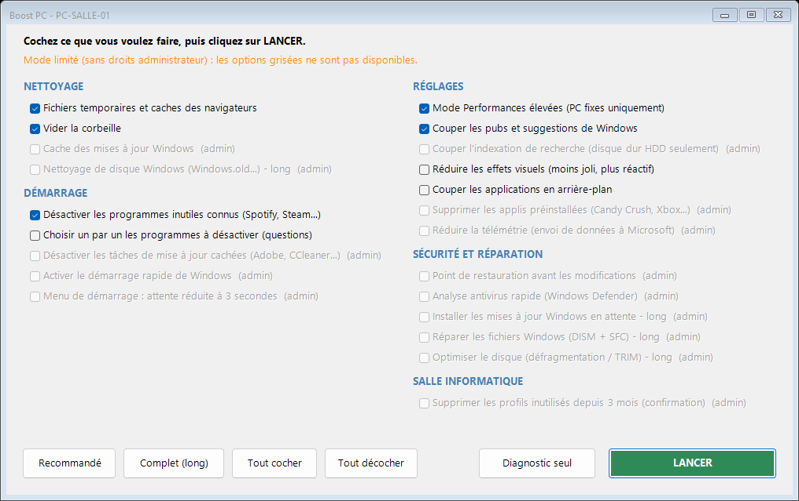

# Boost PC

Petit outil pour **nettoyer et accélérer des PC sous Windows 10/11**, pensé pour les salles informatiques : on copie le dossier sur chaque PC, on double-clique, on coche ce qu'on veut faire, et c'est parti.

- Aucune installation, aucun logiciel tiers : uniquement des outils intégrés à Windows (PowerShell).
- Aucun document personnel n'est touché (sauf l'option 22, qui demande une confirmation écrite).
- Fonctionne **avec ou sans compte administrateur** (mode limité sans admin).
- Un **rapport par PC** avec diagnostic et conseils matériel (disque dur, mémoire…).

## Télécharger

1. Bouton vert **Code** > **Download ZIP**.
2. **Avant d'extraire** : clic droit sur le ZIP > **Propriétés** > cocher **Débloquer** > OK
   (sinon Windows peut bloquer le lancement des fichiers téléchargés).
3. Extraire : vous obtenez un dossier avec `LANCER.bat`, `BoostPC.ps1` et `LISEZ-MOI.txt`.

## Utiliser

1. Copier le dossier sur le PC (Bureau par exemple) — depuis une clé USB, un partage réseau…
2. Double-cliquer sur **`LANCER.bat`**.
3. Windows demande l'autorisation :
   - **Oui** avec un compte administrateur → toutes les options ;
   - **Non** sans mot de passe admin → **mode limité** (seule la session de l'utilisateur est nettoyée).
4. Cocher les options (ou utiliser les boutons **Recommandé** / **Complet**), puis **LANCER**.
5. Accepter le redémarrage à la fin.

Les cases cochées sont mémorisées dans `choix.txt` : réglez-les une fois, copiez le dossier, et tous les PC auront la même sélection par défaut.
Les rapports sont enregistrés dans le sous-dossier `Rapports`.

## Les options

| # | Option | Admin | Par défaut |
|---|---|:-:|:-:|
| 1 | Fichiers temporaires et caches des navigateurs (mots de passe et favoris conservés) | | ✔ |
| 2 | Vider la corbeille | | ✔ |
| 3 | Cache des mises à jour Windows | ✔ | ✔ |
| 4 | Nettoyage de disque Windows (Windows.old, anciennes mises à jour) — long | ✔ | |
| 5 | Désactiver au démarrage les programmes inutiles connus (Spotify, Steam, Teams perso…) | | ✔ |
| 6 | Passer en revue chaque programme du démarrage (questions O/N) | | |
| 7 | Désactiver les tâches de mise à jour cachées (Adobe, CCleaner…) — navigateurs conservés | ✔ | ✔ |
| 8 | Activer le démarrage rapide de Windows | ✔ | ✔ |
| 9 | Réduire à 3 s l'attente du menu de démarrage | ✔ | ✔ |
| 10 | Mode Performances élevées (ignoré sur les portables) | | ✔ |
| 11 | Couper pubs et suggestions de Windows | | ✔ |
| 12 | Couper l'indexation de recherche (disque dur HDD uniquement) | ✔ | ✔ |
| 13 | Réduire les effets visuels | | |
| 14 | Couper les applications en arrière-plan | | |
| 15 | Supprimer les applis préinstallées (Candy Crush, Xbox, Solitaire…) | ✔ | |
| 16 | Réduire la télémétrie Microsoft | ✔ | |
| 17 | Point de restauration avant les modifications | ✔ | ✔ |
| 18 | Analyse antivirus rapide (Windows Defender) | ✔ | ✔ |
| 19 | Installer les mises à jour Windows en attente — long | ✔ | |
| 20 | Réparer les fichiers Windows (DISM + SFC) — long | ✔ | |
| 21 | Optimiser le disque (défragmentation HDD / TRIM SSD) — long | ✔ | |
| 22 | Supprimer les profils inutilisés depuis 3 mois — **efface leurs documents**, confirmation écrite | ✔ | |

Les programmes désactivés au démarrage ne sont pas désinstallés : ils se réactivent dans le Gestionnaire des tâches (Ctrl+Maj+Échap > Démarrage).

## À savoir

- **Un PC qui met plusieurs minutes à démarrer a presque toujours un disque dur mécanique (HDD).** Le nettoyage aide, mais le remplacer par un SSD change tout. Le rapport indique le type de disque de chaque PC.
- Si les PC utilisent un logiciel de restauration au redémarrage (Deep Freeze, Reboot Restore…), les modifications seront annulées : le désactiver d'abord.
- Si l'établissement bloque PowerShell, le programme ne pourra pas se lancer.
- Outil fourni tel quel, sans garantie : testez-le d'abord sur un PC.

## Licence

[MIT](LICENSE)
